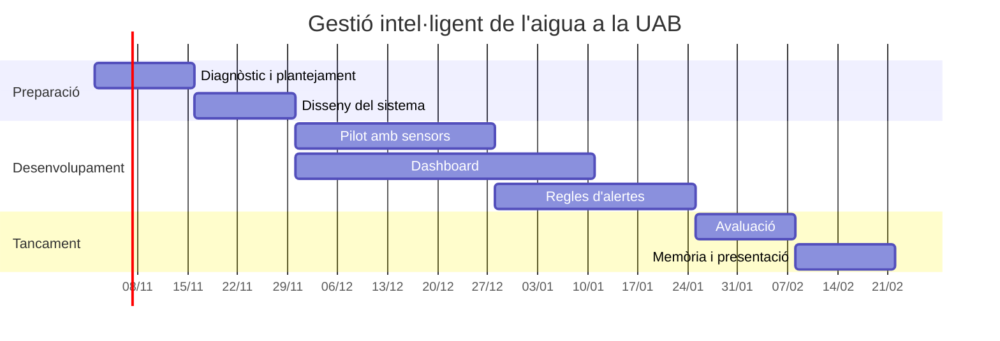

# Gestió intel·ligent de l'aigua a la UAB

Proposta de projecte · Grau en Gestió de Ciutats Intel·ligents i Sostenibles · Universitat Autònoma de Barcelona

Sistema per reduir el consum d'aigua al campus de la UAB mitjançant sensors de consum i fuites, i un dashboard per visualitzar les dades i detectar consums anòmals.

## Prototip del dashboard

Obre `dashboard_aigua_uab.html` amb doble clic (necessita connexió a internet per a les llibreries i el mapa base).

> **Les dades són simulades.** S'han creat per mostrar el funcionament de l'eina i no representen consums reals de la UAB. Les ubicacions al mapa són orientatives.

El prototip inclou mapa del campus, indicadors clau, evolució diària, perfil horari, comparació entre zones, filtres per zona i període, i un panell d'alertes. Les regles de detecció són: consum nocturn sostingut (possible fuita), pic puntual i reg fora de pauta. S'han introduït tres anomalies a propòsit per demostrar que el sistema les detecta.

## Criteris mínims d'èxit

Considerarem que el projecte ha assolit l'èxit si, en acabar el curs, compleix com a mínim aquests criteris:

| # | Criteri | Com ho comprovarem |
|---|---------|--------------------|
| 1 | **Pàgina web del projecte publicada** amb la descripció, els objectius, la planificació i els resultats. | La pàgina és accessible públicament (GitHub Pages) i està enllaçada des d'aquest README. |
| 2 | **Prototip de dashboard funcional** amb mapa del campus, indicadors clau, gràfics de consum i filtres per zona i període. | El dashboard s'obre sense errors i tots els filtres actualitzen el mapa, els indicadors i els gràfics. |
| 3 | **Detecció automàtica d'anomalies** amb almenys tres regles (fuita nocturna, pic puntual i reg fora de pauta). | El panell d'alertes detecta el 100 % de les anomalies introduïdes a les dades de prova, sense falses alarmes a les zones sense anomalies. |
| 4 | **Proposta de desplegament de sensors** al campus: on col·locar-los, quin tipus i quantes dades recullen. | Hi ha un document amb la ubicació dels sensors per zona i la justificació de cada tria. |
| 5 | **Estimació de l'impacte**: aigua que es podria estalviar si es detecten i reparen les fuites a temps. | S'inclou un càlcul raonat de l'estalvi potencial (m³ i %) a partir de les dades del prototip o de fonts públiques. |
| 6 | **Seguiment de la planificació**: el projecte avança segons el diagrama de Gantt. | Cada etapa té les seves tasques al tauler Kanban i, com a mínim, el 80 % estan a "Fet" a la data prevista. |
| 7 | **Memòria i presentació finals** entregades dins del termini. | Entrega al Campus Virtual i presentació oral feta a la data fixada. |

## Rols de l'equip

Cada membre té un rol principal, però tothom participa en les decisions importants i en la revisió final de cada entrega.

| Membre | Rol | Responsabilitats principals |
|--------|-----|-----------------------------|
| Joan German | **Coordinació i repositori** | Gestiona el repositori i el GitHub Project, convoca les reunions, vetlla pels terminis i fa les entreges al Campus Virtual. |
| Pol Gamez | **Recerca i contingut** | Recull informació sobre el consum d'aigua a la UAB i casos similars, redacta els objectius i la memòria i cuida la coherència dels textos. |
| Daniel Tormo | **Dades i desenvolupament** | Defineix els criteris d'èxit i els indicadors, dissenya les regles d'alertes i desenvolupa el dashboard i la pàgina web del projecte. |
| Gerard Rios | **Planificació i avaluació** | Manté el diagrama de Gantt i el tauler Kanban, proposa la ubicació dels sensors, avalua els resultats del prototip i prepara la presentació visual. |

## Etapes del treball

1. Diagnòstic i plantejament
2. Disseny del sistema
3. Pilot amb sensors
4. Dashboard
5. Regles d'alertes i calibratge
6. Avaluació
7. Ampliació i tancament

## Planificació (diagrama de Gantt)

Dates orientatives, amb inici el 2 de novembre de 2026.

## Fonts i llicències

Mapa base: OpenFreeMap, © OpenStreetMap. Llibreries: MapLibre GL JS i Chart.js (CDN jsDelivr).
